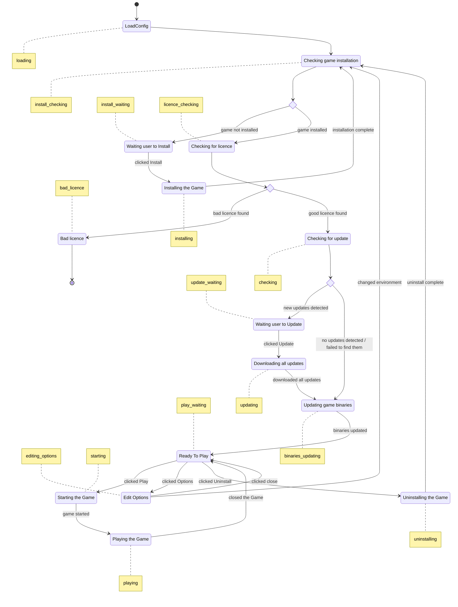

# Launcher

This electron application aims to create a launcher for PSDK Games, it gives what's necessary to update and run the game.

## How to set up

The launcher is configured through a `config.json` file. Edit this file **before building** the launcher: it is bundled into the application.

### Sample configuration

Copy the content below in a file named `config.json` that is located in the `scr` folder. Replace every `<PLACEHOLDER>` with your own values:

```json
{
  "gamePath": "%appdata%/<YOUR_GAME_FOLDER>/games/<channel>",
  "protectedPaths": [
    "Saves/**",
    "<OTHER_PATHS_TO_KEEP_ON_UPDATE>/**"
    ],
  "licenseUrl": "<LICENSE_CHECK_URL>",
  "channels": {
    "github": {
      "installUrl": "<URL_OF_THE_FULL_GAME_ZIP>",
      "installVersion": "<VERSION_OF_THE_FIRST_INSTALL>",
      "updateSource": "github",
      "githubUrl": "https://github.com/<OWNER>/<REPOSITORY>",
      "binariesUrl": "https://github.com/PokemonWorkshop/PokemonSDKBinaries/releases/download/",
    },
    "<OTHER_CHANNEL_NAME>": {
      "installUrl": "<URL_OF_THE_FULL_GAME_ZIP>",
      "installVersion": "<VERSION_OF_THE_FIRST_INSTALL>",
      "updateSource": "server",
      "serverUrl": "<URL_OF_THE_DIRECTORY_CONTAINING_LATEST_JSON_AND_ZIP_FILES>",
      "binariesUrl": "https://github.com/PokemonWorkshop/PokemonSDKBinaries/releases/download/"
    }
  },
  "socialLinks": {
    "website": "<URL_OR_EMPTY>",
    "discord": "<URL_OR_EMPTY>",
    "instagram": "<URL_OR_EMPTY>",
    "x": "<URL_OR_EMPTY>",
    "facebook": "<URL_OR_EMPTY>",
    "youtube": "<URL_OR_EMPTY>",
    "tiktok": "<URL_OR_EMPTY>",
    "bluesky": "<URL_OR_EMPTY>"
  }
}
```

### Fields

- `gamePath` (required): where the game is installed. `%appdata%` is replaced by the user's app data folder and `<channel>` (keep it as is) by the selected channel name, so each channel gets its own install folder.
- `protectedPaths` (required): paths, relative to the game folder, that updates never overwrite or delete (e.g. `Saves/**` to keep player saves). Use an empty array `[]` if there is none.
- `licenseUrl` (optional): URL used to check the player's licence (`?key=<key>&user=<user>` is appended). When omitted, no licence check is done.
- `channels` (required): the release channels the user can pick from. At least one channel is required; channel names are unrestricted (`stable`, `beta`, ...). The launcher restores the saved channel if it still exists; otherwise, it selects and saves the first channel listed in this object. Each channel has:
  - `installUrl` (required): URL of the ZIP used for the first installation.
  - `installVersion` (required): semantic version (`1.0.0`) of that ZIP. It is stored in the install manifest to know which updates are newer.
  - `updateSource` (required): `"server"` or `"github"`.
    - `"server"` requires `serverUrl`: the URL of a directory containing `latest.json` and version-named ZIP files. The launcher first fetches `latest.json`, which must contain an object such as `{"version": "abc-1.2.3"}`, then downloads the corresponding archive (`abc-1.2.3.zip`) from the same directory when the update is applied.
    - `"github"` requires `githubUrl`: the repository URL (`https://github.com/<owner>/<repository>`). Its latest GitHub release tag must be a semantic version and the release must contain exactly one `.zip` asset.
  - `binariesUrl` (required): download URL of the PSDK game binaries. The default value works for standard PSDK games.
- `socialLinks` (required): links displayed in the launcher. All eight keys must be present, use `""` for the ones you don't have.

Versions may have a prefix containing any number of letters, hyphens, or underscores before the three-part version, for example `v1.2.3`, `Game_1.2.3`, or `abc-1.2.3-beta.1`. Prefixes are ignored when comparing versions.

## How it works

The launcher is a single page application that handles all the different views thanks to a state machine. The single page allows the launcher to run animations over the elements of the page.

### State Machine

The state machine is handled inside `LauncherContext.tsx`, it has 15 states:

- `loading`: when the launcher loads its configuration
- `install_checking`: when the launcher checks whether the game is installed
- `install_waiting`: when the launcher waits for the user to install the game
- `installing`: when the launcher installs the game
- `licence_checking` : when the launcher is checking for licence
- `bad_licence` : when the launcher finds a bad licence. The user cannot start the game.
- `checking`: when the launcher is checking for update
- `update_waiting`: when the launcher is waiting for the user to say "Yes I want to download updates"
- `updating`: when the launcher is downloading and applying updates
- `binaries_updating`: when the launcher is updating its game binaries
- `play_waiting`: when the launcher is waiting for the user to say "Yes I want to play"
- `starting`: when the launcher is starting the game
- `playing` : when the launcher is playing the game
- `editing_options`: when the launcher lets the user edit game options
- `uninstalling`: when the launcher uninstalls the game

Here's the state diagram:



> Note: To see the diagram please install the vscode extension `bierner.markdown-mermaid`.
> You might need to re-open preview.
